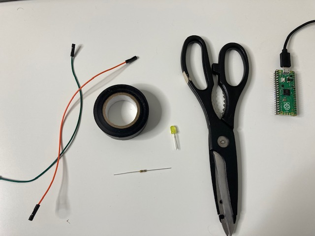
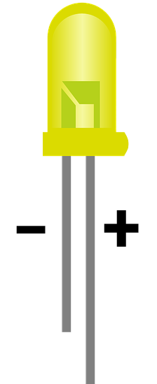
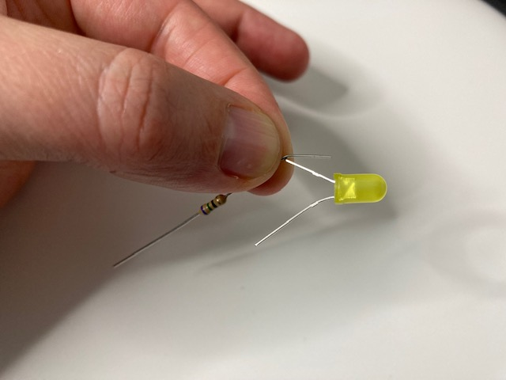
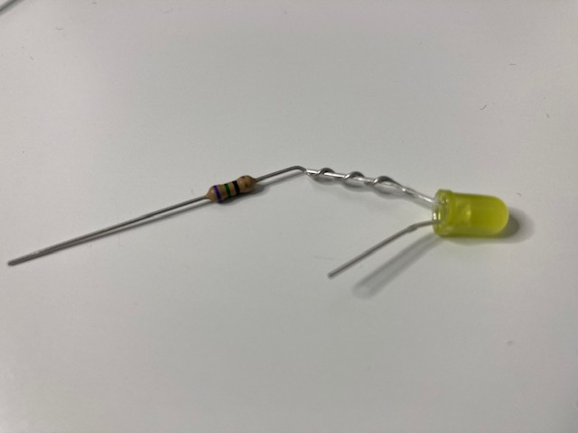
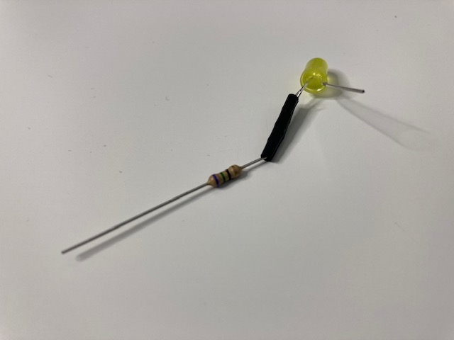
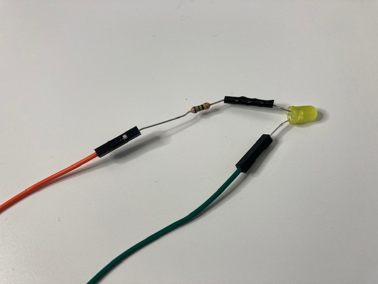

## Reúne los componentes

Necesitarás:
+ 2 x cables puente receptáculo a receptáculo
+ 1 x resistencia
+ 1 x diodo LED
+ Cinta aislante
+ Tijeras

## Identifica la patita positiva de un LED

Un LED tiene una patita **positiva** y una patita **negativa**. La patita larga es positiva y la patita corta es negativa.

{:width="200px"}

**CONSEJO**: Otra forma de comprobar si una patita es positiva o negativa es buscar con el dedo el lado plano del cuerpo del LED. El **lado plano** está del mismo lado que la patita **negativa**.

## Enrolla la resistencia alrededor de la patita positiva del LED

Dobla una de las patitas de la resistencia alrededor de la patita positiva del LED.

Enrolla la patita de la resistencia alrededor de la patita del LED unas tres veces.

## Asegura la resistencia con cinta aislante

Corta un trocito de cinta aislante y pégalo alrededor de la patita enrollada de la resistencia. Esto ayudará a que quede un poco más firme.

## Conecta los dos cables puente

Conecta un cable puente al otro extremo de la resistencia.

Conecta el otro cable puente a la patita negativa del LED.

**CONSEJO**: Si quedan muy flojos, coloca un poco más de cinta aislante sobre las uniones.
